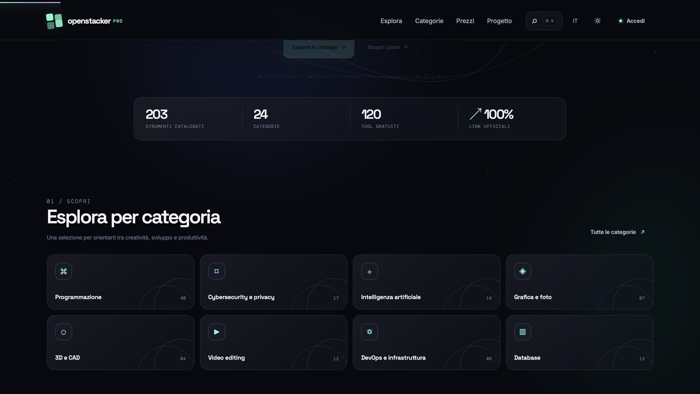

# OpenStacker Pro

<p align="center">
  <b>Modular, Reactive, High-Performance Web Platform for Managing and Cataloging Technology Resources</b>
</p>

<p align="center">
  <a href="https://github.com/nowii-core/OpenStacker-Pro/actions/workflows/ci.yml">
    
  </a>
  <a href="https://github.com/nowii-core/OpenStacker-Pro/blob/main/LICENSE">
    
  </a>
  
  
  
</p>

<p align="center">
  <a href="#-overview">Overview</a> •
  <a href="#-key-features">Features</a> •
  <a href="#-project-architecture">Architecture</a> •
  <a href="#-tech-stack">Tech Stack</a> •
  <a href="#-quick-start">Quick Start</a> •
  <a href="#-testing">Testing</a> •
  <a href="#-contact">Contact</a>
</p>

---

</div>

## Overview

**OpenStacker Pro** is a modern, modular web application designed to provide a smooth, fast user experience without the burden of heavy commercial frameworks. Built according to *Clean Code* principles and a component-separated architecture, it integrates native catalog management, internationalization (i18n) support, data persistence through Supabase, and an automated unit testing pipeline.

---

## Preview



> **Live Demo:** (https://nowii-core.github.io/openstacker/)](https://nowii-core.github.io/openstacker/OpenStacker-Pro%205/)

---

## Key Features

- **Responsive Design & Fluid UI:** Layout optimized with advanced Flexbox and CSS Grid for a consistent experience across desktop, tablet, and smartphone.
- **Built-in Internationalization (i18n):** Dynamic language switching (Italian / English) with user preference persistence.
- **Integrated Dynamic Catalog:** Filtering, quick search, and performant rendering of catalog items.
- **Framework-Free Architecture:** Built with pure JavaScript (ES6+) and modular CSS to maximize load speed and eliminate dependency on heavy bundles.
- **Supabase Backend Integration:** Secure database management and data persistence via the integrated Supabase client.
- **Test Suite & Continuous Integration:** Active CI pipeline with GitHub Actions for automated quality control on every release.

---

## Tech Stack

### Frontend
- **HTML5:** Semantic markup compliant with WCAG standards for accessibility.
- **Modular CSS3:** System based on Design Tokens (`tokens.css`), base styles, reusable components, and high-performance animations (`animations.css`).
- **JavaScript (ES6+):** Object-oriented and modular programming via ES Modules for clean management of internal dependencies.

### Backend & Database
- **Supabase / PostgreSQL:** Dedicated relational schema (`supabase/schema.sql`) for data management and synchronization.

### Tooling & Quality
- **Node.js Test Runner:** Unit tests to verify business logic and module integrity.
- **GitHub Workflows:** Automated build, linting, and testing in an integrated environment.

---

## Project Architecture

```
OpenStacker-Pro/
├── .github/                 # Issue/PR templates and CI/CD workflows
│   └── workflows/           # Automated pipelines (ci.yml, pages.yml)
├── assets/                  # Icons, SVG graphic assets, and static resources
├── scripts/                 # Development server and local CLI utilities
├── src/
│   ├── css/
│   │   ├── tokens.css       # Global variables, colors, and typography
│   │   ├── base.css         # CSS reset and fundamental styles
│   │   ├── components.css   # Isolated UI components
│   │   └── animations.css   # Keyframes and transitions
│   └── js/
│       ├── config.js        # Application constants and endpoints
│       ├── i18n.js          # Multilingual localization system
│       ├── backend.js       # API / Supabase client
│       ├── catalog.js       # Catalog management and rendering
│       ├── effects.js       # Animations and interactive effects
│       └── main.js          # Client logic entry point
├── supabase/                # Configuration files and SQL schema
├── tests/                   # Unit and integration test suite
├── index.html               # Main application page
├── package.json             # Dev dependencies and project scripts
└── README.md                # Project documentation
```

---

## Quick Start

### Prerequisites
- **Node.js** v18.0.0 or higher
- **npm** v9.0.0 or higher

### Installation

1. **Clone the repository:**
   ```bash
   git clone https://github.com/nowii-core/OpenStacker-Pro.git
   cd OpenStacker-Pro
   ```

2. **Install development dependencies:**
   ```bash
   npm install
   ```

3. **Start the local development server:**
   ```bash
   npm run dev
   ```
   The application will be accessible at `http://localhost:3000`.

---

## Testing

To run the local test suite and verify module stability:

```bash
# Runs all automated tests
npm test
```

Tests cover catalog logic, verification of core files, and application support utilities.

---

## License

This project is distributed under the **MIT** license. See the [`LICENSE`](./LICENSE) file for more information.

---

## Contact & Support

- **Maintainer:** [@nowii-core](https://github.com/nowii-core)
- **Bug Reports & Feature Requests:** If you encounter an issue or would like to suggest an improvement, open an [Issue](https://github.com/nowii-core/OpenStacker-Pro/issues) or submit a [Pull Request](https://github.com/nowii-core/OpenStacker-Pro/pulls).

---

<div align="center">
  <sub>Developed by <b>nowii-core</b></sub>
</div>
